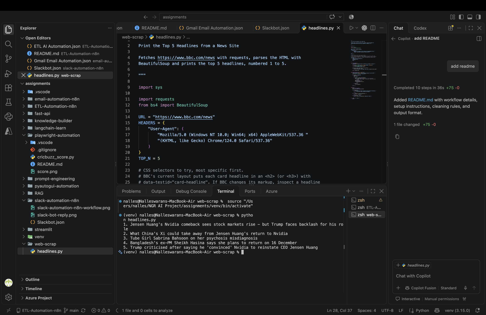

# BBC News Headline Scraper

A simple Python script that downloads the BBC News homepage, extracts the
latest headlines, removes duplicates, and prints up to five results to the
terminal.



## How it works

1. Reads the target news URL from `config.json`.
2. Sends an HTTP GET request using a browser-style User-Agent header.
3. Checks that the response is successful.
4. Parses the HTML with BeautifulSoup.
5. Tries a set of headline CSS selectors.
6. Prints up to five unique headline texts.

## Files

- `headlines.py` - headline scraper
- `config.json` - external news URL configuration
- `webscrap-output.png` - screenshot of the script in a terminal

## Configuration

Change the target website by editing `config.json`:

```json
{
  "news_url": "https://www.bbc.com/news"
}
```

Use an absolute HTTP or HTTPS address for the news page. The script exits with
a clear message if `config.json` is missing, contains invalid JSON, or does not
provide a non-empty `news_url` value. Configuration is loaded relative to
`headlines.py`, so it works regardless of the directory from which the script
is launched.

## Requirements

- Python 3
- `requests`
- `beautifulsoup4`

## Set up

From this directory, create and activate a virtual environment:

```bash
python3 -m venv .venv
source .venv/bin/activate
```

On Windows, activate it with:

```powershell
.venv\Scripts\Activate.ps1
```

Install dependencies:

```bash
python -m pip install requests beautifulsoup4
```

## Run

```bash
python headlines.py
```

Example output:

```text
1. Latest BBC headline
2. Another current headline
3. Another current headline
```

The output is live and may differ from the screenshot because BBC News
publishes and updates headlines continuously.

## Behavior

- The target URL is loaded from `config.json` before the HTTP request.
- Missing configuration, invalid JSON, and missing `news_url` values produce
  clear terminal errors.
- Requests fail gracefully with a clear error message.
- Non-200 HTTP responses are reported.
- Duplicate and empty headline values are skipped.
- The script prints fewer than five headlines if the page does not expose enough
  content.
- A message is printed if no usable headlines are found.

## Maintenance

BBC may change its HTML structure or load some content through JavaScript.
The script attempts several selectors, starting with the most specific:

```text
[data-testid="card-headline"]
h2[data-testid]
main h2
h2
```

If BBC changes its markup, inspect a headline element in a browser and update
the `SELECTORS` list in `headlines.py`. This scraper does not execute JavaScript,
so headlines rendered only by client-side JavaScript may not be available in
the downloaded HTML.

## Responsible use

Use this script only where permitted by BBC's website terms and robots policy.
Avoid sending frequent requests, and do not use it to bypass access controls or
paywalls.
